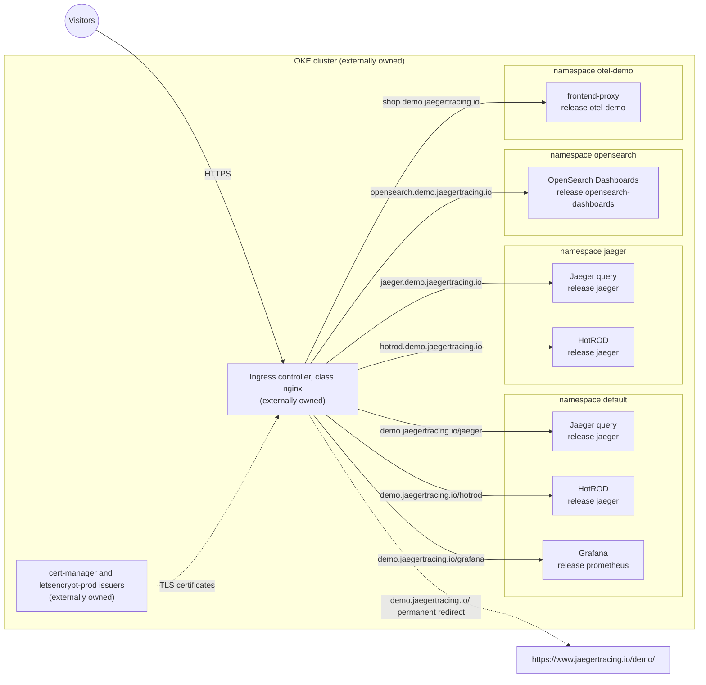
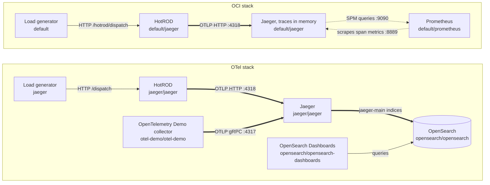
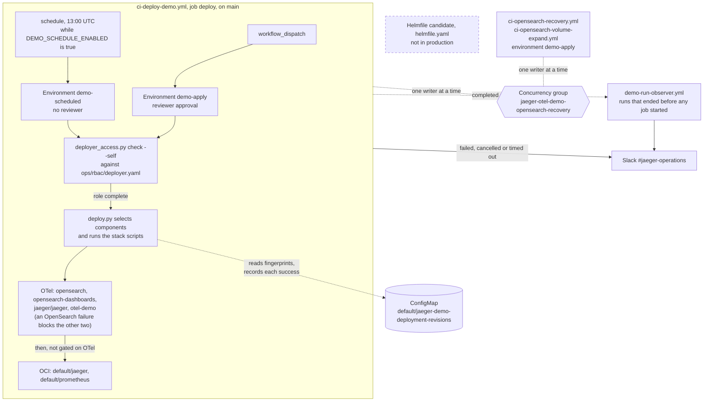

<!-- Copyright (c) 2026 The Jaeger Authors. -->
<!-- SPDX-License-Identifier: Apache-2.0 -->

# Jaeger hosted demos

Configuration and operations for the public Jaeger demos on the existing Oracle
Kubernetes Engine (OKE) cluster. Jaeger and HotROD source, image publishing,
product releases and integration tests remain in
[jaegertracing/jaeger](https://github.com/jaegertracing/jaeger).

The daily 13:00 UTC job covers both Jaeger stacks, OpenSearch and Dashboards,
the OTel sample application, and OCI monitoring. It runs the same workflow job
and [deploy.py](scripts/demo/deploy.py) as a manual deployment, without a
reviewer, and only while the `DEMO_SCHEDULE_ENABLED` repository variable is
`true`. For current migration status and handover evidence, see
[docs/MIGRATION.md](docs/MIGRATION.md). Schedule activation is tracked in the
[handover runbook](docs/cutover.md#review-scheduled-scope).

## Public endpoints

| URL | Stack | Backing service | Storage |
| --- | --- | --- | --- |
| https://demo.jaegertracing.io/jaeger | OCI | Jaeger query UI | In-memory |
| https://demo.jaegertracing.io/grafana | OCI | Grafana (Prometheus stack) | Prometheus |
| https://demo.jaegertracing.io/hotrod | OCI | HotROD sample application | In-memory traces in Jaeger |
| https://demo.jaegertracing.io/ | OCI | Permanent redirect to https://www.jaegertracing.io/demo/ | None |
| https://jaeger.demo.jaegertracing.io | OTel | Jaeger query UI | Traces in OpenSearch |
| https://hotrod.demo.jaegertracing.io | OTel | HotROD sample application | Traces in OpenSearch (via Jaeger) |
| https://opensearch.demo.jaegertracing.io | OTel | OpenSearch Dashboards | OpenSearch |
| https://shop.demo.jaegertracing.io | OTel | OpenTelemetry Demo storefront (`frontend-proxy`) | Traces in OpenSearch (via Jaeger); shop data stays in the demo's own PostgreSQL and Valkey |

Routes are defined in [examples/oci/ingress.yaml](examples/oci/ingress.yaml),
[ingress-jaeger.yaml](examples/otel-demo/ingress/ingress-jaeger.yaml),
[ingress-opensearch.yaml](examples/otel-demo/ingress/ingress-opensearch.yaml) and
[ingress-otel-demo.yaml](examples/otel-demo/ingress/ingress-otel-demo.yaml).

## Architecture and ownership

| Stack | Namespace | Application releases | Configuration |
| --- | --- | --- | --- |
| OCI, memory storage and HotROD | `default` | `jaeger`, `prometheus` | [examples/oci](examples/oci) |
| OTel, OpenSearch storage | `jaeger` | `jaeger` | [examples/otel-demo](examples/otel-demo) |
| OTel storage and dashboards | `opensearch` | `opensearch`, `opensearch-dashboards` | [examples/otel-demo](examples/otel-demo) |
| OTel sample application | `otel-demo` | `otel-demo` | [examples/otel-demo](examples/otel-demo) |

The first diagram maps each public route through the ingress to its namespace and
Helm release. Routes and TLS issuers come from the Ingress manifests listed above.

The second diagram follows the traces. Thick arrows carry traces and dotted
arrows carry metrics. Nodes are labelled `namespace/release`. Endpoints come from
both `jaeger-values.yaml` files, `config.yaml`, `monitoring-values.yaml`,
`jaeger-config.yaml`, `otel-demo-values.yaml`, `opensearch-dashboard-values.yaml`
and the two load generators, which are supplemental manifests outside the Helm
releases.

The deployment workflow uses [scripts/demo/deploy.py](scripts/demo/deploy.py) to
select changed components and invoke the stack scripts. The snapshot resolver
selects Jaeger and HotROD images independently from upstream core commits. This
repository's commit identifies configuration, never a product image.

One job, `deploy` in
[ci-deploy-demo.yml](.github/workflows/ci-deploy-demo.yml), serves both triggers
on `main`. A maintainer's dispatch waits for a `demo-apply` reviewer. The 13:00 UTC
schedule uses `demo-scheduled`, which has no reviewer, and runs only while the
`DEMO_SCHEDULE_ENABLED` repository variable is `true`. Before any cluster change
the job checks that its credential holds the role in
[ops/rbac/deployer.yaml](ops/rbac/deployer.yaml) ([deployer access](docs/deployer-access.md)),
and the stack scripts install charts only from archives that match
[scripts/demo/chart-archives.lock.json](scripts/demo/chart-archives.lock.json). The deployment,
OpenSearch recovery and volume-expansion workflows share one concurrency group, so
one of them runs at a time.

A scheduled run selects both Jaeger components every day, to refresh the snapshot
images, plus every component whose fingerprint differs from its key in the
ConfigMap. It upgrades existing releases in place only. A dashed outline marks the
Helmfile candidate. It is validated locally and in PR CI; production continues to
run the extracted scripts until operator acceptance
([migration plan](docs/MIGRATION.md)).

Existing namespaces, release names, routes, Service addresses and PVCs are
preserved. Certificate issuers and the shared cluster, ingress controller and
cert-manager are externally owned. Their installation examples are retained as
history; they are not migration instructions. Cluster provisioning, DNS changes
and AI activation are outside this migration.

## Development

Local checks need Bash, Git, jq, Helm, ShellCheck, actionlint, shunit2, ruff and
Python 3 with PyYAML and cryptography. Use Python 3.11 or later: the
`pycparser` pin in
[oci-cli-constraints.txt](scripts/demo/oci-cli-constraints.txt), which
`cryptography` pulls in through `cffi`, requires it. The tests use mocks and
render public Helm charts without production credentials. Chart rendering
requires network access.

[CONTRIBUTING.md](CONTRIBUTING.md#local-checks) has the install commands, the
shunit2 checkout, `make lint`, `make test` and `make check`, plus credential-free
Renovate discovery, DCO, issues and required checks. [AGENTS.md](AGENTS.md) covers
agent work.

## Operations and releases

- [Migration phases, decisions and exit criteria](docs/MIGRATION.md)
- [Access and ownership handover](docs/cutover.md)
- [Deployment releases, provenance, verification and rollback](docs/releases.md)
- [Current script reconciler and maintenance](scripts/demo/README.md)
- [OCI stack commands](examples/oci/README.md)
- [OTel stack commands](examples/otel-demo/README.md)

Use the handover and release runbooks for the existing installation. Do not run
historical installation, `clean`, recovery or cleanup commands merely to complete
the migration. The daily OpenSearch upgrade preserves its existing PVC and
verifies new trace ingestion and query. Generated trace history is disposable.
During Stage 1, maintainers can separately request a manual tested backup. Retirement of that
tooling and the narrow manual reset belong to [Helmfile conversion](https://github.com/jaegertracing/jaeger-demo/issues/1).

## Extraction provenance

Imported from upstream `main` at
[`bcef01d0c848d5be0416c2eee117d5d306416dd7`](https://github.com/jaegertracing/jaeger/commit/bcef01d0c848d5be0416c2eee117d5d306416dd7).
The filtered history retains 55 authored commits and the new repository's seed
history. See [extraction.md](docs/extraction.md) for the path list, commit mapping,
minimal adapters and verification. Merge the extraction PR with a merge commit;
squashing would remove the imported ancestry from `main`.

### To rehome

Open core PRs touching imported paths at the cutoff are listed below. Rehome only
hosted-demo changes after coordinating the original review; this list does not
approve or merge their proposed behavior. The analytics change
[#10141](https://github.com/jaegertracing/jaeger/pull/10141) was already merged and
is included in the cutoff.

| Core PR | Relevant work |
| --- | --- |
| [#10131](https://github.com/jaegertracing/jaeger/pull/10131) | Bounded AI assistant; activation remains outside migration scope |
| [#10174](https://github.com/jaegertracing/jaeger/pull/10174) | Routine disposable-trace policy for the hosted schedule is implemented in [demo #15](https://github.com/jaegertracing/jaeger-demo/pull/15). Manual recovery has its own opt-in path. |
| [#10180](https://github.com/jaegertracing/jaeger/pull/10180) | Manual restore Pod startup, rehomed in [demo #14](https://github.com/jaegertracing/jaeger-demo/pull/14) |
| [#10031](https://github.com/jaegertracing/jaeger/pull/10031) | Grafana probes and demo smoke checks |
| [#10172](https://github.com/jaegertracing/jaeger/pull/10172) | Ported the recovery API helpers and their regression tests. See the [recovery procedure](examples/otel-demo/OPENSEARCH_RECOVERY.md). |
| [#10155](https://github.com/jaegertracing/jaeger/pull/10155) | Hosted configuration portions of the batch migration; core configuration stays in core |
| [#9149](https://github.com/jaegertracing/jaeger/pull/9149) | Inspect only its `ci-deploy-demo.yml` hunk; the critical-path work stays in core |
