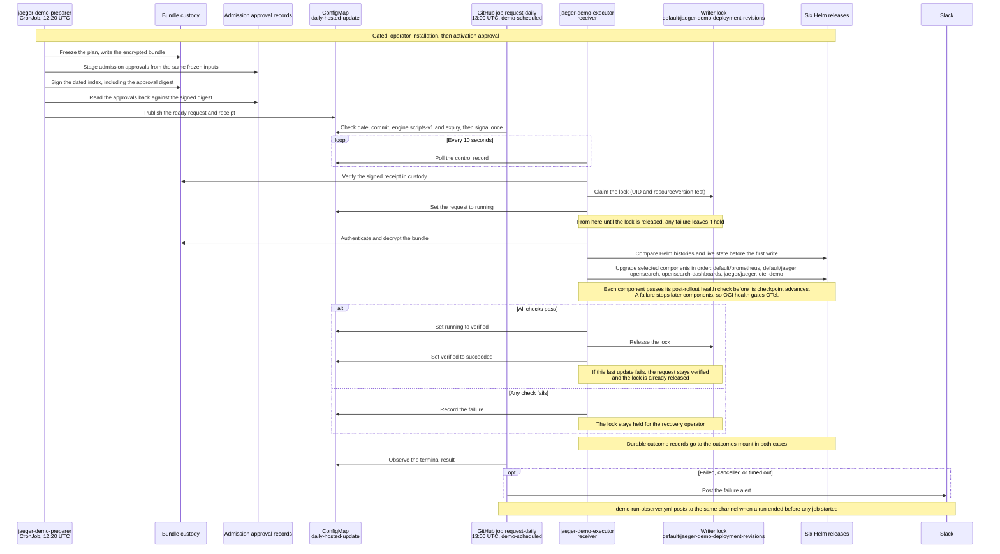

<!-- Copyright (c) 2026 The Jaeger Authors. -->
<!-- SPDX-License-Identifier: Apache-2.0 -->

# In-cluster scheduled executor

The trusted preparer publishes the day's private, signed bundle. The executor independently authenticates that bundle and claims the same durable writer lock used by manual operations. The GitHub job supplies one signal and observes the result. The manifests, service accounts, keys and cluster permissions require operator installation before activation. [Daily request protocol](daily-update-request.md) · [Receiver entry point](../scripts/demo/scheduled_receiver.py)

## Daily sequence

Each step below is described in this page, the [daily request protocol](daily-update-request.md) and the [release guide](releases.md). None of it runs until operators install the workloads and a maintainer approves activation: the preparer CronJob first, then the `DEMO_SCHEDULE_ENABLED` repository variable. Manual jobs in the `demo-apply` environment take the same writer lock instead of signalling. A failure before the lock release leaves the lock held. A request left `verified` after the release has no holder, and the recovery operator finalizes it ([concurrency and recovery](daily-update-request.md#concurrency-and-recovery)).



## Processes and credentials

Run `python3 /opt/jaeger-demo/scripts/demo/scheduled_receiver.py prepare` as the `jaeger-demo-preparer` service account and `serve` as `jaeger-demo-executor`, both in `jaeger-demo-operations`. Each process queries the Kubernetes API for its authenticated username before acting. It writes a temporary kubeconfig pointing at the in-cluster TLS endpoint, projected CA and rotating token file. This kubeconfig also supplies the identity for the fixed application commands.

| Mount | Preparer | Executor |
| --- | --- | --- |
| `/var/run/secrets/kubernetes.io/serviceaccount` | Projected preparer token, CA and namespace | Projected executor token, CA and namespace |
| `/var/lib/jaeger-bundles` | Publish signed index and encrypted bytes | Read only |
| `/var/run/jaeger-bundle-keys` | `signing-key.pem`, `recipient-public.pem`, `verification-key.pem` | `verification-key.pem`, `decryption-key.pem` |
| `/var/lib/jaeger-outcomes` | No mount | Append durable public outcome records |
| `/tmp` | Private scratch directory | Private scratch directory and readiness file |

Run the preparer between 11:00 and 15:00 UTC for the 13:00 UTC slot. If an authenticated slot already exists it reuses the frozen receipt. Otherwise it obtains the reviewed main SHA and freezes the plan. Under the custody lock it writes the encrypted blob, stages the admission approvals from those same inputs and commits their aggregate digest in the signed dated index. Before publishing readiness it reads all approvals back against the signed digest. A retry after the signed index exists verifies these records and uses the frozen receipt without decrypting or resolving a new plan. A partial approval write leaves the slot unpublished. An invalid existing index stops preparation. The GitHub signal and executor claim retain their separate expiry and five-minute acknowledgement deadline.

The receiver polls the fixed control record every ten seconds. A valid signal must match the reviewed engine, the eligible UTC slot and the signed receipt found independently in custody. The code passes only authenticated, decrypted member bytes to the fixed application adapter. Each mutation must check the original request UID, receipt, state and lock holder. After all five checks succeed, the receiver writes its durable verification record, updates the request, releases the lock and reports success. A failed check leaves a failure record and the lock.

After a rollout, Jaeger can report Ready before the generator sends traffic. The
executor polls every ten seconds for its service, a recent matching span and
a completed SPM bucket with calls. It uses up to five minutes or the time
remaining in the claimed deployment, whichever expires first. Each attempt
rechecks the writer lock. A failed route or HTTP request, malformed response,
or invalid latency during observed traffic fails verification immediately.
The initial health check before any rollout still runs once. A failed
post-rollout check leaves the component checkpoint untouched and stops later
components.

## Operations and recovery

Use `python3 /opt/jaeger-demo/scripts/demo/scheduled_receiver.py ready` for the readiness probe. It checks the last successful control observation, or the elapsed time of an active operation. A terminating receiver stops polling on SIGTERM. If it already claimed a bundle but has not started application, it records failure before any application mutation. An already running operation can finish during the Pod termination grace period. A ready receiver can be observing a blocked claim. Its state-change log identifies `inspect-running`, `inspect-verified` or `inspect-failed`. An unreadable control record removes readiness. Receiver-generated logs and outcome files contain public operation metadata only.

Inspect the request, shared checkpoint and `<UTC-date>.<bundle-sha256>.<phase>.json` in the outcomes mount. The `started` file is exclusive. A replacement process observes a prior claim without executing it again. A `started` record without a terminal outcome requires inspection. The application's hard execution budget is 275 minutes. On expiry the Python container entrypoint exits, so Kubernetes terminates its children and the unconfirmed operation retains its lock. Confirm the owning Pod and its subprocesses have stopped, inspect the live releases and receipt, then follow the operator procedure. A `running` claim requires incident handling. A clock or readiness timeout cannot establish that the owner has stopped. [Recovery procedure](daily-update-request.md#concurrency-and-recovery)

## Rehearsal

The local Kubernetes 1.36.0 rehearsal used two independent processes, real API-issued service account tokens, separate projected key directories, a signed index and encrypted synthetic bundle bytes. It exercised two independently stored approval partitions and rejected a signal after one partition was changed. A restarted preparer preserved the signed index and refused to advertise mismatched approvals. It also exercised success, failure, abrupt process exit and receiver restart. The fixed application callback verified fixture files under lock. Both processes ran under the same local OS user, so this test covers Kubernetes authentication and the protocol. Pod security contexts and volume isolation require the separate workload rehearsal. [Recorded checks](../scripts/demo/rehearsals/scheduled-request/receiver-receipt.json)

To repeat on a fresh disposable `kind-jaeger-request-rehearsal` cluster with the repository's Python dependencies installed, run:

```bash
python3 scripts/demo/rehearsals/scheduled-request/probe_receiver.py \
  --kubeconfig "$kind_kubeconfig" --receipt "$new_receipt_path"
```

## Release and installation

The release image and workload node selector target Linux AMD64 on OKE. Pull request CI builds it in a fresh checkout and loads it into a disposable kind node. A project maintainer can publish a reviewed commit after merge through **Publish the demo executor image** on `main`. Supply the full commit as `configuration_sha` and retain the workflow URL and its `ghcr.io/jaegertracing/jaeger-demo-executor@sha256:…` result. The release run builds a single archive and runs its digest in the same disposable-pod rehearsal as pull request CI. Once the rehearsal passes, a fresh runner with GitHub Packages write access retrieves that run’s image archive by artifact ID. It checks the manifest digest, copies the archive to GHCR with digest preservation and reads back the commit tag to verify the same digest before recording the installation image. Only the image archive is transferred. The rehearsal job has read-only repository access, and neither job receives production credentials. The release packages Helm 4.3.2, kubectl 1.36.1, the reviewed Python wheels and a static Helm patch preview helper. A digest-pinned Go 1.27.4 builder verifies its module dependencies and compiles the helper offline for the target architecture. The image verifies both strategic and JSON merge patch output with synthetic objects. The runtime checks the approval modules, helper source, module lock and ABI check against the reviewed main commit. The Containerfile checks each downloaded CLI archive or binary against its platform checksum. [Build](../ops/executor/Containerfile) · [Package publication](../.github/workflows/release-executor.yml)

During preparation, the pod reads the exact public `jaeger-demo/main` commit. It treats configuration blobs as data and checks compatibility against the code in the installed image. Chart versions must match the reviewed archive checksums. The Jaeger chart comes from a pinned Git commit with four checked dependency archives. Both snapshot references bind the independent core commit tag, registry index digest and Linux AMD64 manifest digest. A runtime-code change requires a matching image release. A chart bump requires its version and archive checksum in the same reviewed change. [Public input acquisition](../scripts/demo/scheduled_inputs.py) · [Chart archive checksums](../ops/executor/chart-archives.json)

### Updating a dependency

For a Renovate chart update, use the repository and chart listed in `scheduled_inputs.CHARTS`. Fetch the candidate version from the publisher. Compare the downloaded archive's SHA-256 with the publisher's digest in its Helm repository index. Include the new versioned filename and digest in `ops/executor/chart-archives.json` in the same PR as the version change. A Jaeger chart Git pin change also requires comparing the upstream `Chart.lock` and the checksums of its packaged dependencies. The acquisition code rejects missing, extra and changed archives. Retain the seven-day release-age review and the rendered diff. [Dependency review](releases.md) · [Public input and checksum checks](../scripts/demo/scheduled_inputs.py)

For a Helm, kubectl, Python or Go runtime change, update the version, appropriate platform checksums or image index digest, compatibility checks, and release rehearsal together. Validate the actual Linux AMD64 build and kind job on the reviewed commit. Publish a new image by digest, pause new requests, allow an active transaction to finish, then review the replacement deployment digest. Retain the prior image and custody keys until an operator has verified the replacement against a signed slot. Changing the runtime image in production requires installation approval.

A chart update can also add, rename or remove objects. Preparation rejects any rendered object that
[the access matrix](all-five-chart-access.json) does not list. Before proposing a chart update, run
`python3 scripts/demo/access_matrix.py`. It fetches and verifies the pinned archives, renders the six
releases without cluster access and names every object that lacks a reviewed record, every record
that no chart renders any more, and every changed Helm hook. `--propose` prints draft records. A
person reviews each draft, in particular kinds marked as protected, and edits the matrix by hand; the
tool never writes it. The matrix is executor-guarded, so that edit needs a matching image release
([procedure](releases.md#merging-a-change-to-guarded-files)). The same comparison runs in the
`Monitoring hooks and Helm history` check. It compares names, kinds and scope only: a client render
has no live discovery and no Helm lookup results.

Updating the matrix does not by itself let a scheduled run apply the change. Preparation also requires
the rendered identities to equal those of the live release ("Daily upgrades require an approved
existing object inventory") and protected objects to be unchanged ("Privileged manifest differs from
the operator-established baseline"). A chart update that adds, removes or renames an object, or that
changes a protected one, therefore needs a separately reviewed manual upgrade to establish the new
release before preparation resumes, even with the matrix updated and the matching image installed.

### Installation approval

Use the [production installation review packet](daily-production-install-review.md) to assemble the ordered manifests and their hashes offline. Keep the image digest, configuration commit, exact object list, permission evidence and private key custody destination with the change record. The renderer emits a suspended CronJob and a Deployment at zero replicas. The bootstrap Job is the sole pod launched by applying this manifest. It has no API token and initializes the two directories on the new claim.

```bash
python3 ops/executor/workloads.py --image "$release_image" --storage-class oci-bv \
  --cluster-uid "$verified_kube_system_uid" > workloads.json
```

In your trusted OKE operator context, verify the cluster UID with `kubectl get namespace kube-system -o jsonpath='{.metadata.uid}'` before passing it to the renderer. Both workload roles read this cluster-scoped Namespace and compare its UID with `SCHEDULED_CLUSTER_UID` before reading Helm release state.

The storage request is one new 50 GiB ReadWriteOnce PVC. OKE can provision a billable block volume when the bootstrap Job first mounts it. The receiver and preparer share the volume on the same worker. Each requests 100m CPU, 256 MiB memory and 256 MiB ephemeral storage. Required pod affinity places the preparer on the receiver’s node. Inspect current node pod slots, CSI attachment capacity, allocatable requests, reclaim policy, encryption and headroom for monitoring hook Jobs and rollout surges before asking to install. The operations pods accept no inbound connections. The rendered NetworkPolicy allows DNS, HTTPS and the Kubernetes API, plus three namespace-scoped TCP ports for OpenSearch and Jaeger health checks. Public HTTPS destinations are unrestricted. The OCI instance metadata HTTP port is outside these rules. Check CNI enforcement, other additive policies, DNS, Service translation and API connectivity on OKE during commissioning. [OCI metadata endpoint](https://docs.oracle.com/en-us/iaas/Content/Compute/Tasks/gettingmetadata.htm). Restrict access to creating or modifying pods and Jobs in this namespace, since that access could expose the key mounts. [OCI Block Volume provisioning](https://docs.oracle.com/en-us/iaas/Content/ContEng/Tasks/contengcreatingpersistentvolumeclaim_topic-Provisioning_PVCs_on_BV.htm) · [Kubernetes volume access modes](https://kubernetes.io/docs/concepts/storage/persistent-volumes/#access-modes)

Generate the two key pairs under operator custody only after installation approval. Create `jaeger-demo-preparer-keys` and `jaeger-demo-executor-keys` separately from the files listed in the table above. Supply Secret content from files, keep shell tracing disabled, and record only the public key fingerprints in the installation receipt. Match any private recovery copy to an explicitly authorized shared vault destination. Rehearse public-key readback, encrypted bundle readback and failure recovery with the isolated identities before enabling any scheduled signal. Keep each runnable pod at the tested image digest. [Custody, rotation and retention](daily-bundle-custody.md)

### Activation approval

With the daily GitHub switch off, drain manual writers, check the shared lock and install the reviewed admission rules before the corresponding role bindings. Scale the receiver to one and check readiness. Use a one-off preparer Job copied from the suspended CronJob to validate the six installed releases, the PVC binding, the verified snapshot images and today's signed receipt without sending a deployment request. Match that receipt to the configuration commit that the GitHub requester would observe. Compare the actual effective permissions and negative admission probes with the approved installation. Record any refusal before proceeding. [Actor bindings and recovery](daily-update-request.md#set-up-once)

Ask the maintainer separately before enabling the 12:20 UTC preparer and the 13:00 UTC GitHub signal. Turn on the preparer first, confirm it can publish the intended slot, then set the repository variable `DEMO_SCHEDULE_ENABLED=true` for that slot. To pause, clear that variable and suspend the preparer CronJob. Check both the request state and the lock before scaling down the receiver or making a manual change. Keep incident and prior rollback bundles until the recovery operator closes the case. A clean shutdown preserves the PVC and both private key Secrets. The 32-slot capacity limit requires an operator retention review before the store fills. [Daily release checks](releases.md) · [Custody retention](daily-bundle-custody.md)

## Evidence for an independent review

| Question | Reproduction and evidence |
| --- | --- |
| Can the GitHub identity choose a different configuration, replay yesterday's request or mark a failure successful? | The request admission policy binds each transition to its own actor and the slot, commit, digest and expiry. The API rehearsal uses negative requests and preserves a failed slot across recovery. [Request tests and receipts](../scripts/demo/rehearsals/scheduled-request/README.md) |
| Does a Pod restart repeat a deployment or expose both private keys? | The kind rehearsal uses two Pods, their projected service accounts, different key projections, one bound PVC and a read-only bundle mount for the executor. It exercises success, failure, restart and the retained writer lock using a synthetic application callback. [Runtime fixture](../scripts/demo/rehearsals/executor-runtime/README.md) |
| Can the actual monitoring hooks change their jobs or credentials? | The API tests use the exact twelve pinned definitions and their own service accounts. They reject altered commands and images, Roles, bindings, archive bytes and mutations to the live webhook or CRD specification. A separate kind test executes the chart's hooks on upgrade and rollback. [Native admission results](../scripts/demo/rehearsals/helm-history/monitoring-hook-access.json) · [Monitoring hook execution](../scripts/demo/rehearsals/monitoring-writer/README.md) |
| Will a real Helm client run with these permissions? | The real Jaeger charts exercise client-side and server-side apply on both releases. Inheriting the stored apply method can require a PATCH even when Kubernetes stores identical content. The fixtures compare live state, test readiness and reject denied operations before the first write. [Jaeger API audit](../scripts/demo/rehearsals/helm-history/jaeger-patch-methods.json) · [Six charts and recovery](../scripts/demo/rehearsals/helm-history/README.md) |
| Who can see production Secrets? | The two in-cluster workload accounts can read Secrets in the four release namespaces because Helm uses Secret storage. Namespace/PVC administrators, recovery-key holders and the independent preparer are trusted. The scheduled GitHub credential signals the request and observes its result. Kubernetes authorization and storage access need independent checks on OKE. [Grant inventory](daily-executor-permissions.md) · [Custody](daily-bundle-custody.md) |
| What requires the real cluster? | Verify the released digest can be pulled, OKE node and volume capacity, key projection and custody, effective grants and admission, live six-release planning, rollback records and public health. The first actual daily transaction must write and read a new trace, preserve Service/PVC identities and pass both stacks' health checks. [Release acceptance](releases.md) |
